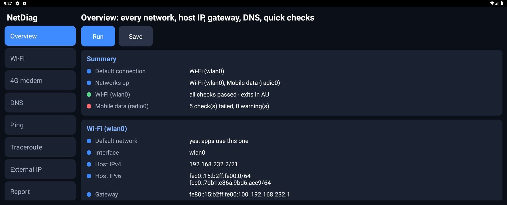
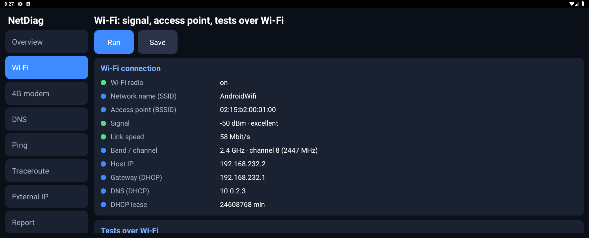
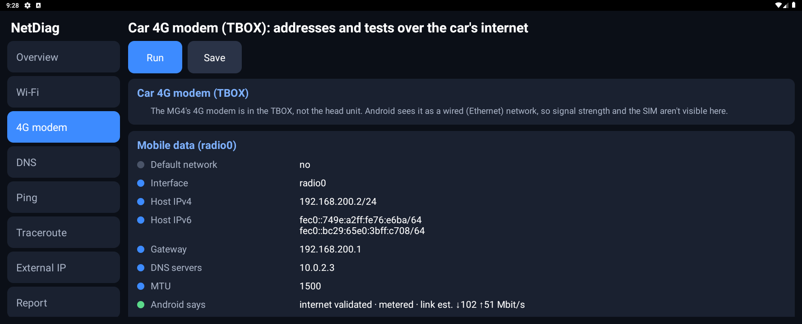
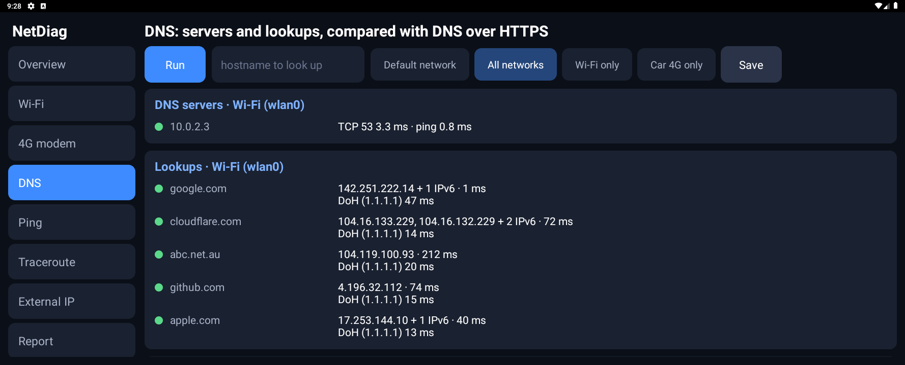
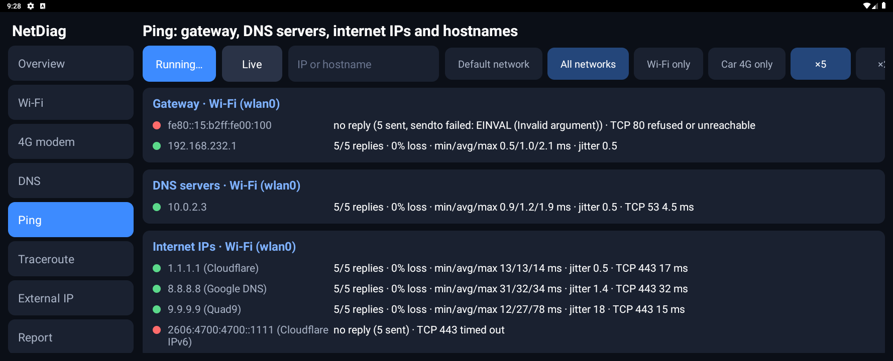
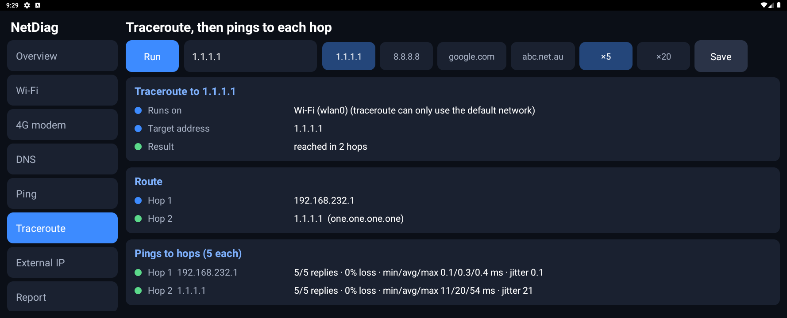
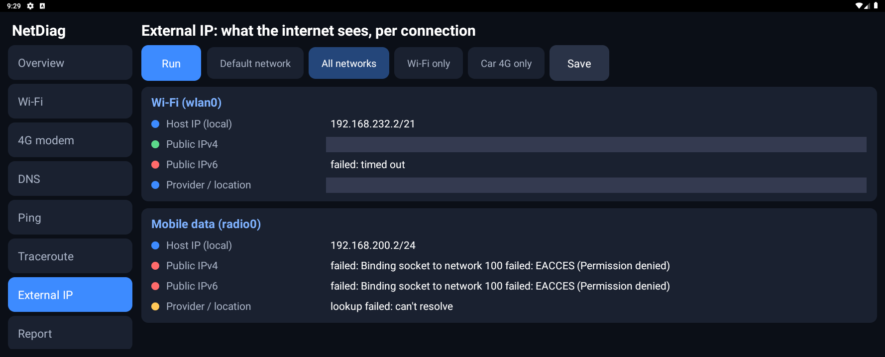
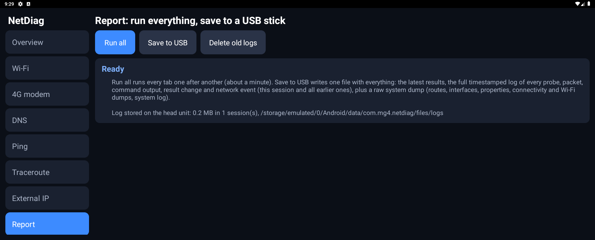

# MG4 NetDiag

Network and internet diagnostics for the MG4 head unit (SAIC, Android 9, 1778 × 720). Unofficial.

## Tabs

| Tab | What it does |
|---|---|
| Overview | Every network Android has (Wi-Fi, car 4G modem, VPN): host IPv4/IPv6, gateway, DNS servers, MTU, validated/metered, then per network: ping gateway, DNS lookup, ping 1.1.1.1, HTTP 204 check, external IP and country. Also every kernel interface. |
| Wi-Fi | SSID, BSSID, RSSI, link speed, band/channel, DHCP gateway/DNS/lease, tests bound to Wi-Fi, nearby networks. SSID needs the Location permission and Location on. |
| 4G modem | The car's 4G is the TBOX, which Android sees as Ethernet. Addresses and tests bound to it, plus whatever the head unit's own telephony reports (usually nothing). Warns when it exits outside Australia. |
| DNS | Each DNS server (TCP 53, ping, reverse name), lookups of common hosts with timing, compared with DNS over HTTPS via 1.1.1.1. Add your own hostname. |
| Ping | Gateway, DNS servers, 1.1.1.1 / 8.8.8.8 / 9.9.9.9 (+ IPv6), hostnames, and your own target. ×5 or ×20. Each ping also tries TCP, so "ICMP filtered" and "unreachable" read differently. **Live** pings gateway, 1.1.1.1 and google.com every second. |
| Traceroute | Hops to a target (`ping -t TTL`), reverse names, then pings to each hop (mtr-style). |
| External IP | Public IPv4/IPv6, country and Cloudflare POP (Cloudflare trace), provider and city (ipinfo.io), CGNAT hint. |
| Report | Runs every tab, then **Save to USB** writes one file with everything (below). Every tab also has Save. **Delete old logs** removes earlier sessions. |

Network choice (Default / All / Wi-Fi only / Car 4G only) applies to Ping, DNS and External IP.

## Everything is logged

From the moment the app opens, a timestamped log (to the millisecond) is written to the head unit as it happens: `Android/data/com.mg4.netdiag/files/logs/session-*.log`. Nothing is replaced and nothing is lost when the app closes. It records:

- every ICMP packet (reply time or timeout), every ping summary, the raw output of every shell `ping`/traceroute command
- every DNS lookup and reverse lookup, every TCP connect, every HTTP request with response headers and body
- every result row as it appears and every change to it (including each Live ping reply), every note
- every network event: networks appearing, lost, default changing, capabilities and link changes with Android's full details
- tab switches, button presses, settings, permissions, app lifecycle, errors with stack traces, crashes

Old sessions are kept until they pass 200 MB, then the oldest go.

**Save to USB** writes one file: the latest results of every tab, then a raw system dump taken at that moment (`ip addr/route/rule/neigh`, `ifconfig`, `netstat`, `getprop`, `/proc/net/*`, `ping_group_range`, Android's view of each network, Wi-Fi scan, `dumpsys connectivity/netd/wifi/netstats/ethernet/telephony.registry/netpolicy`, `logcat -b all`), then every stored session log in full.

`dumpsys` and the full system log need the **platform-signed** build (`DUMP`, `READ_LOGS`). The debug build records "Permission denial" there and only its own log lines.

## How it reaches each network

Android sends unbound traffic over the default network only. To test Wi-Fi and the car modem separately, pings use an unprivileged ICMP socket bound with `Network.bindSocket`, and DNS, TCP and HTTP use the `Network`'s own resolver, socket factory and `openConnection`. If ICMP sockets are refused, pings fall back to `/system/bin/ping` (default network only). Traceroute always uses the shell ping (default network only), because "time exceeded" replies need the socket error queue.

## Screenshots

Taken on an Android 9 emulator at 1778 × 720 (the head unit's resolution), so there is no car TBOX network. Public IP and location are blacked out.

| | |
|---|---|
|  |  |
|  |  |
|  |  |
|  |  |

## Build

```sh
./gradlew testDebugUnitTest lintDebug assembleDebug assembleRelease
```

- `app/build/outputs/apk/debug/app-debug.apk`: install from a USB stick with the head unit's file manager.
- Release (R8, ~140 KB) signed with the platform key from `../DiPlay-MG4/tools` (never committed):

```sh
zipalign -f -p 4 app/build/outputs/apk/release/app-release-unsigned.apk dist/aligned.apk
apksigner sign --key platform.pk8 --cert platform.x509.pem --out dist/MG4NetDiag-0.2.0-platform.apk dist/aligned.apk
apksigner verify --print-certs dist/MG4NetDiag-0.2.0-platform.apk   # SHA-256 c8a2e9bc…92ab8
```

## Verified on the car

From a saved report on an MG4 (AUTUS SAIC, firmware SWI165-29176-1100R11, Android 9, app 0.2.0 platform build):

- The 4G modem is the TBOX: Android reports it as `tbox0`, transport **ETHERNET**, static addressing with the TBOX as gateway and DNS server, ~100 Mbit/s link estimate, metered. The head unit's own telephony reports no modem (OUT_OF_SERVICE).
- ICMP ping sockets bound to a specific network work (`via ICMP`). `ping_group_range` is `0 2147483647`.
- The platform build can read `dumpsys` (connectivity, wifi, ethernet, netstats, netpolicy, telephony.registry) and the full `logcat -b all`, with no permission denials. `dumpsys netd` does not exist on this firmware ("Can't find service").
- Traceroute (`ping -t`) reached 1.1.1.1 in 13 hops with reverse names.
- Typical results: gateway ~1 ms, internet ~300 ms, DNS lookups 3-7 ms (cached) but 300 ms to 1.1 s for uncached names.
- The car's traffic exited outside Australia, which is why Australian-only sites can refuse it. The app flags this.

Not yet checked: Wi-Fi tests (the Wi-Fi radio was on but not connected), and the debug build on the car.
